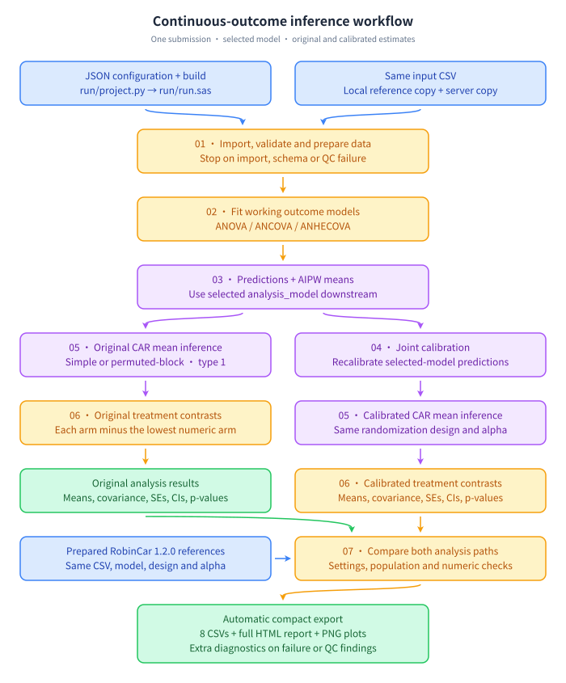

# Robust Covariate Adjustment under CAR in SAS

All SAS code in this repository is run using SAS Viya.

An independent research implementation of continuous-outcome AIPW estimation,
joint calibration, CAR variance and treatment contrasts, checked against
RobinCar **1.2.0**.

## Quick start

Create your local configuration, then edit the server paths in
`utilities/config.local.json`:

```bash
python run/project.py init
```

Choose a workflow below. **Use `inference` for the complete analysis**;
the three workflows are independent.

| Workflow | Purpose | Build command |
|---|---|---|
| `smoke` | Test calculations and invalid-input handling with synthetic data; no uploads or R needed. | `python run/project.py build smoke` |
| `outcome_models` | Check ANOVA/ANCOVA/ANHECOVA fits, with optional base-R comparison. | `python run/project.py build outcome_models` |
| `inference` | Run the full analysis, compare with RobinCar, and export results and plots. | `python run/project.py build inference` |

Submit the **entire generated `run/run.sas` file** to the SAS session.
Each build replaces this file and embeds its configuration and dependencies.
For inference, prepare the input data, matching R references and export directory
first; follow [the quick start](doc/quickstart.md) for setup and success checks.
Rebuild whenever sources or configuration change.

## Inference workflow



The left path uses the selected model’s predictions and AIPW estimates directly;
the right path first applies joint calibration. Both paths compute CAR standard
errors, confidence intervals and treatment contrasts in one SAS submission.
Arrows show data dependencies.

## Support and validation

Select `ANOVA`, `ANCOVA` or `ANHECOVA` through `analysis_model` in the JSON
configuration; the default is `ANCOVA`. The integrated three-arm ANCOVA workflow
passed comparison with RobinCar 1.2.0; see [the verification record](doc/validation_status.md).
Other model/design combinations have different validation coverage.

The main workflow supports continuous outcomes and marginal normal inference;
missing-outcome analysis, nonlinear contrasts and multiplicity adjustment are
not implemented. See [supported features and limits](doc/support_matrix.md),
[statistical methodology](doc/methodology.md) and
[program summaries](doc/README.md) for details.

## Repository layout

| Directory | Contents |
|---|---|
| [sas/](sas/README.md) | Programs 01–07 and inference/export orchestration |
| [run/](run/README.md) | Entry-point builder and generated SAS submission |
| [utilities/](utilities/README.md) | JSON configuration and shared helpers |
| [data/](data/README.md) | Example input CSV |
| [validation/](validation/README.md) | SAS tests, comparison suite and R reference exporters |
| [doc/](doc/README.md) | Setup, methodology, data contracts and verification records |

[examples/](examples/README.md) contains an unvalidated binomial/MI example;
[notebooks/](notebooks/README.md) contains an exploratory placeholder.
Generated references and build manifests are stored in `output/` and ignored by Git.
